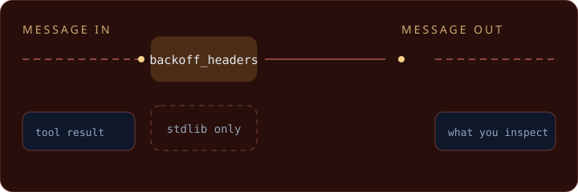

<p align="center">
  
</p>

<p align="center">
  <a href="https://pypi.org/project/backoff-headers/"></a>
  <a href="https://pypi.org/project/backoff-headers/"></a>
  <a href="https://pypi.org/project/backoff-headers/"></a>
  <a href="https://github.com/sandeshbagmare/backoff-headers/actions/workflows/ci.yml"></a>
  <a href="https://github.com/sandeshbagmare/backoff-headers/blob/main/LICENSE"></a>
  <a href="https://sandeshbagmare.github.io/backoff-headers/"></a>
  <a href="https://pypi.org/project/backoff-headers/"></a>
</p>

<h3 align="center">turn a rate-limit header into the exact time to wait</h3>
<p align="center"><em>Standard library only. No runtime dependencies. Python 3.9+.</em></p>

<p align="center">
  
</p>

## Install

```console
pip install backoff-headers
```

## API

```python
from backoff_headers import (
    format_retry_after, parse_rate_limit, parse_retry_after, wait_time,
)

parse_retry_after("120")                            # 120.0
parse_retry_after("Wed, 21 Oct 2015 07:28:00 GMT")  # seconds until then, 0.0 if past

limit = parse_rate_limit(response.headers)
limit.limit, limit.remaining, limit.window, limit.policy
limit.exhausted                  # remaining == 0
limit.seconds_until_reset()

wait_time(headers, cap=60, jitter=2.0)   # never longer than 60s, spread by up to 2s
format_retry_after(1.2)                  # "2", rounded up so you never retry early
```

`reset_style` on `parse_rate_limit` is `"auto"` (an implausibly large reset is treated
as a timestamp), `"delta"` or `"epoch"` when you know what your server sends. `now` is
accepted everywhere a clock is needed, which is what makes the behaviour testable.

Both header families are read case-insensitively, and RFC 9331 wins when a server
sends both.

## Design notes

- Precedence: `Retry-After`, then an exhausted quota's reset, then `default`.
- `jitter` adds `uniform(0, jitter)`, so a fleet of clients does not retry in lockstep.
- `cap` is applied after the jitter, so a cap is never exceeded.
- Nothing sleeps, nothing retries: the caller owns the loop and the clock.

## Development

```console
python -m venv .venv
.venv/bin/pip install -e ".[test]"
.venv/bin/pytest
```

## License

MIT.
